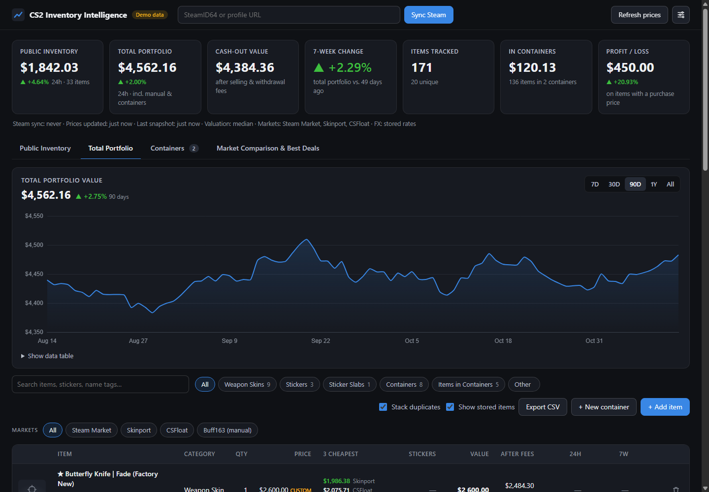
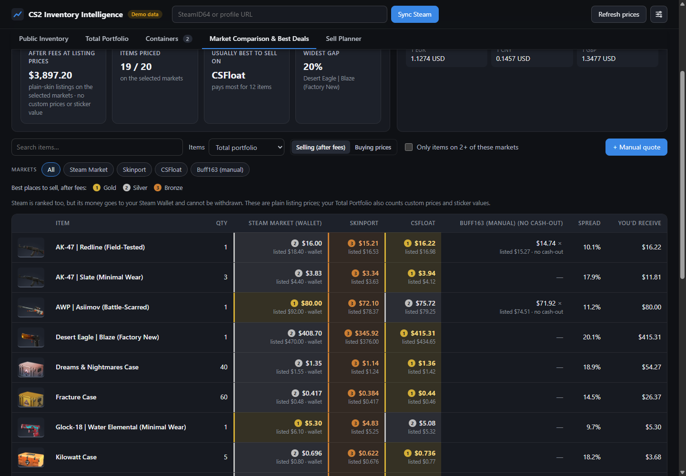
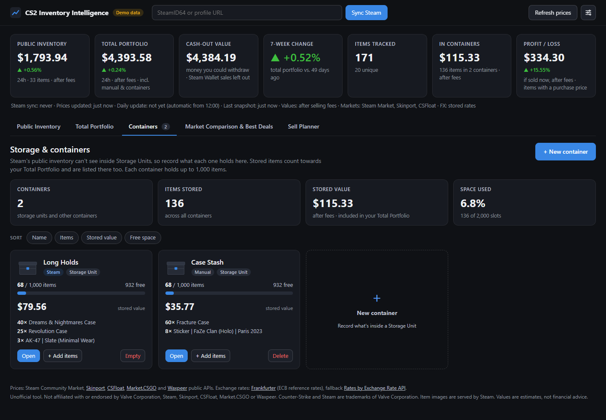
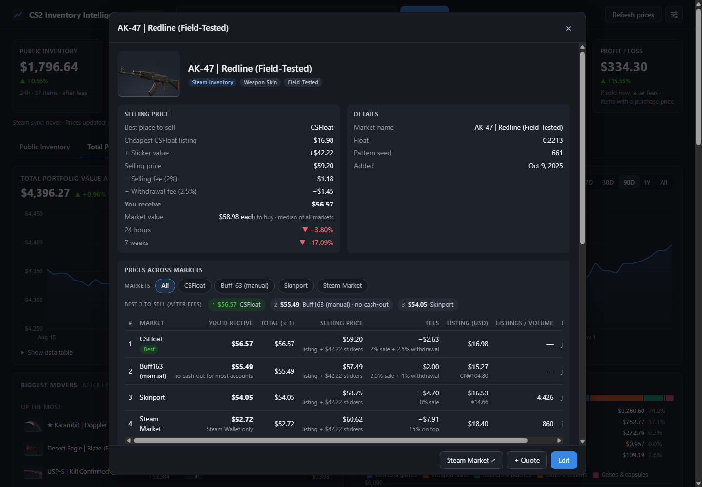

# CS2 Inventory Intelligence

A local dashboard that tracks what your Counter-Strike 2 inventory is worth across **Steam, Skinport, CSFloat,
Market.CSGO and Waxpeer**, including your storage units, the real value of applied stickers, and how much cash
you'd actually walk away with after each site's fees.

It runs entirely on your own computer, only ever **reads** public price data, and never asks for your Steam
login.



> Screenshots use the built-in demo mode: a made-up inventory with synthetic prices.

## Features

- **Steam inventory sync**: paste your SteamID64 or profile link and your public CS2 inventory is imported,
  including applied stickers, name tags, and wear/pattern where Steam provides them.
- **Five markets plus your own**: lowest listings from the Steam Community Market, Skinport, CSFloat,
  Market.CSGO and Waxpeer, plus manual quotes for any other site (e.g. BUFF163) in any currency.
- **One currency**: every price is converted to your base currency (GBP, USD, EUR, CNY, …) with that day's
  European Central Bank rates, so comparisons are fair.
- **Containers and storage units**: Steam can't see inside Storage Units, so record what each one holds (up to
  1,000 items), with stacking, partial moves and removals, and a capacity bar.
- **Realistic sticker values**: applied stickers add only a share of their loose price. Where the stickers are
  worth more than the skin, the item is valued from real CSFloat listings and sales of the same skin with the
  same stickers.
- **What you'd really get**: every price and value is what you'd receive selling, after each market's selling
  and withdrawal fees. The item view breaks it down step by step (listing price, sticker value, each fee). A
  separate *Cash-out value* counts only money you can withdraw, since Steam Wallet money can't be.
- **No silly prices**: rarely traded items often have one listing priced far above what they sell for (say a
  Sticker Slab listed at £1,500 that sells for 62p). Those listings are spotted and ignored automatically, using
  recent sales, the other markets and, for slabs, the sticker inside. The item view shows what was ignored and why.
- **History**: a daily snapshot builds 7-day to all-time charts of your portfolio and of each item on every
  market, after fees.
- **Easy to explore**: sort any column, filter by category or market, see the 3 best markets to sell every
  item on, compare buying prices too, and export to CSV.

| Market comparison | Containers | Item detail |
|---|---|---|
|  |  |  |

## Quick start (Windows)

1. Install **Python 3.10 or newer** from [python.org](https://www.python.org/downloads/) and tick
   *"Add python.exe to PATH"* during setup.
2. Download this project: click the green **Code** button on this page, then either copy the link and run
   `git clone <link>`, or choose **Download ZIP** and unzip it.
3. Double-click **`launch.bat`**. The first run installs what it needs (1–2 minutes), then the dashboard opens
   in your browser at <http://127.0.0.1:5000>.
4. Paste your **SteamID64** into the box at the top and press **Sync Steam**. You can find it at
   *store.steampowered.com/account*. Your Steam inventory privacy must be set to **Public**.

To add a desktop shortcut (with an icon you can pin to the taskbar), run:

```powershell
powershell -ExecutionPolicy Bypass -File scripts\create-desktop-shortcut.ps1
```

**Just want to look around?** Run `launch.bat --demo` (or `python app.py --demo`) to open the app with a
synthetic demo inventory, stored separately from your real data.

### macOS, Linux, or manual setup

```bash
python3 -m venv .venv
source .venv/bin/activate          # Windows: .venv\Scripts\activate
pip install -r requirements.txt
cp .env.example .env               # optional - edit to add a CSFloat key
python app.py --open
```

The app keeps running while its window is open. Whenever you open it, it brings everything up to date straight
away (the **daily update**: Steam re-sync, prices, snapshot, if it hasn't run yet today), then refreshes prices
when they're over 12 hours old while it stays open. **Refresh prices** fetches immediately, any time.

**Keep it updating while the app is closed (Windows):** this adds a scheduled task, for your account only, that
runs the daily update in the background with no window, never before 12:00: at 12:00 if the PC is on, or as soon
as it's on after that. If the markets can't be reached (say the internet is down), it tries again the next hour.
Once today's update has happened, by the task or because you opened the dashboard, it does nothing more until
tomorrow; those hourly checks only read your local database and use no internet. Each run is noted in
`data\update.log`. Days the PC is off all day are skipped; charts carry the last value across.

An update downloads about 5–6 MB (mostly the Skinport, Market.CSGO and Waxpeer price lists, plus Skinport's
sales history, which is fetched at most once a day). The one-per-item CSFloat and Steam requests are small and
spaced seconds apart, so they never hog a slow connection.

```powershell
powershell -ExecutionPolicy Bypass -File scripts\install-daily-update.ps1           # add -DryRun to preview
powershell -ExecutionPolicy Bypass -File scripts\install-daily-update.ps1 -Remove   # remove it again
```

To use another time, set `DAILY_UPDATE_TIME` in `.env` and pass the same time to the script with `-Time`.

On other systems, schedule `python app.py --update` with cron or similar.

## Configuration

Settings live in a **`.env`** file next to `app.py`. Copy `.env.example` to `.env`; every value is optional.
Most of them can also be changed later in the app's **Settings** dialog.

| Setting | What it does |
|---|---|
| `CSFLOAT_API_KEY` | Enables CSFloat prices and sticker comparisons (see below). |
| `STEAM_ID64` | Your SteamID64, so you don't have to paste it each time. |
| `BASE_CURRENCY` | Currency everything is shown in, e.g. `GBP`, `USD`, `EUR`. |
| `ENABLED_MARKETS` | Any of `steam,skinport,csfloat,marketcsgo,waxpeer`. |
| `VALUATION_STRATEGY` | How an item's *market value* (its buying price, shown for reference) is picked from several markets: `median` (default), `lowest`, `highest`, `mean`, or a single market. |
| `STICKER_RATE_MIN` / `MAX`, `STICKER_PREMIUM_CAP` | Tune the sticker formula (5–15 % of loose price, capped at 100 % of the skin's price by default). |
| `HOST`, `PORT` | Where the local server listens (default `127.0.0.1:5000`; keep `127.0.0.1` so only your PC can open it). |
| `AUTO_DAILY_SNAPSHOT`, `AUTO_SYNC_STEAM` | Turn the automatic daily update and Steam re-sync on or off. |
| `DAILY_UPDATE_TIME` | Earliest time of day for the automatic background update (default `12:00`). |
| `ITEM_IMAGES` | Find pictures for items you add by hand (default `true`). |

### API keys

The only key the app can use is an **optional CSFloat API key**: log in at [csfloat.com](https://csfloat.com),
open **Profile → Developers**, create a key, and put it in `.env` as `CSFLOAT_API_KEY=...`. Everything else
(Steam inventory, Steam Market, Skinport, Market.CSGO, Waxpeer, exchange rates) uses public, keyless endpoints.

- The key stays in your `.env` (which is git-ignored), is sent only to csfloat.com, and never reaches your
  browser.
- **This app never needs a Steam Web API key, so don't create one for it.** Fake "API key" pages are a common
  way to steal CS2 items. See [SECURITY.md](SECURITY.md).

## How values are worked out

- **Market prices**: each market's cheapest current listing of the item, converted with that day's exchange rate.
- **Selling price** (what every price and value on the page shows): the most you'd receive on any market after
  its fees. For each market, that's its cheapest listing plus your stickers' value, minus the selling fee and
  withdrawal fee; the best market wins. Steam counts too, marked as Steam Wallet money. A **custom price** you
  set (or a CSFloat-comparables value) is treated as the item's full price and sold where fees are lowest.
- **Price check**: a listing is ignored when it's more than 3 times (and at least $1 above) the item's recent
  sales (Skinport's sales history, or Steam's median sale price), or without sales, its price on the other
  markets. A Sticker Slab with neither is compared with the sticker inside: a slab can be cracked open to get its
  sticker back, so it's worth at least that much, and is ignored above 4 times it. Cheap listings are never
  ignored. When every listing is ignored, the item is valued from its recent sales, or a slab from the sticker
  inside. This is a simple statistical rule rather than a trained model, so each decision can be explained.
  Rare patterns and floats aren't priced separately: an item is valued like the cheapest copy of that skin,
  so set a custom price for one that's worth more.
- **Market value**: what the item would cost to buy (the median of the markets by default), shown for reference
  in the item view and the Total portfolio tile's tooltip.
- **Applied stickers**:
  - Each sticker adds 5–15 % of its cheapest loose price. The rate rises on a log scale from $1 to $100
    stickers, is ×1.2 for four identical stickers, and is reduced by scrape.
  - The total is capped relative to the skin's own price, approaching the cap gradually.
  - When the stickers are worth more than the skin and a CSFloat key is set, the item is valued from CSFloat
    instead: recent sales and listings of the same skin with the same valuable stickers. Comparables carrying
    other valuable stickers are set aside, and asking prices are discounted. This is re-checked daily, and the
    item view shows the evidence.
- **Fees** (defaults as of November 2026, editable in Settings). The **Cash-out value** tile sells each item on
  the best market you can withdraw from:

  | Market | Selling fee | Withdrawal fee | Counts as cash? |
  |---|---|---|---|
  | Steam Market | 15 % on top of your amount (5 % Steam + 10 % CS2) | – | No, Steam Wallet only |
  | Skinport | 8 % (6 % on items worth €1,000+) | none | Yes |
  | CSFloat | 2 % | 2.5 % (lower at higher sales volume) | Yes |
  | Market.CSGO | 5 % | ~3 % (varies by method) | Yes |
  | Waxpeer | 6 % | ~2 % (crypto) | Yes |
  | BUFF163 (manual quotes) | 2.5 % | 1 % | No by default (only verified Chinese residents can withdraw) |

- **History and 24h / 7-week changes** come from the app's own daily snapshots, so they appear once it has run
  long enough. Item history is worked out after fees from each market's saved daily prices. Portfolio totals
  saved by older versions (at market value) are converted once, using each day's saved prices.

## Data sources and limitations

- **Steam Community Market** prices come from an unofficial public endpoint that Steam rate-limits heavily.
  The app spaces out its requests, backs off when Steam says "slow down" (HTTP 429), and doesn't try to get
  around it. Steam prices can therefore be missing for a while; the app retries every 12 hours.
- **Skinport, Market.CSGO and Waxpeer** publish free price lists. They're fetched once and cached for 30
  minutes. **CSFloat** uses its official API. Skinport's public **sales history** (what items actually sold for
  over the last 7–90 days) is fetched the same way and used for the price check.
- **Item names** for autocomplete come from CSFloat's public item list (downloaded weekly, no key needed) plus
  the market price lists, so you can add items nobody is selling right now, such as an unlisted Sticker Slab.
- **Pictures for items you add by hand** are looked up in [ByMykel's CSGO-API](https://github.com/ByMykel/CSGO-API)
  item catalogue on GitHub. Only the file for that kind of item is downloaded (about 1 MB), at most once a day,
  and the pictures themselves load from Steam like synced items. Set `ITEM_IMAGES=false` to turn this off.
- **Marketplaces that need your login** (such as BUFF163) are deliberately not automated. Add their prices
  as manual quotes.
- **Storage Unit contents** aren't visible in public Steam inventories, so they're entered by hand.
- **Estimates only**: fees change, sticker values are estimates, and none of this is financial advice.

## Privacy and security

- **Local and read-only**: the server only listens on `127.0.0.1`, there are no accounts, and nothing can trade
  or move items.
- **Your data stays private**: your keys (`.env`), database and exports (`data/`) are git-ignored.
- **Privacy check**: `scripts/check_secrets.py` blocks API keys, real SteamIDs, email addresses, personal file
  paths and private files from being committed. Turn on the pre-commit hook in your clone with
  `git config core.hooksPath .githooks`.
- **Reporting problems**: see [SECURITY.md](SECURITY.md) for what the app will never ask for, and how to report
  a vulnerability.

## Development

```bash
pip install -r requirements-dev.txt
python -m pytest                     # test suite (no network needed)
python scripts/check_secrets.py      # privacy check of everything that would be committed
```

| Path | Contents |
|---|---|
| `app.py`, `config.py` | Entry point and settings |
| `backend/` | Flask API, SQLite storage, Steam sync, market sources, valuation, fees, history |
| `static/`, `templates/` | The dashboard (vanilla JavaScript + Chart.js) |
| `tests/` | pytest suite |
| `scripts/` | Privacy check, desktop-shortcut helper and the daily-update scheduled task |

## Credits

- **Price data:** Steam Community Market, [Skinport](https://skinport.com), [CSFloat](https://csfloat.com),
  [Market.CSGO](https://market.csgo.com) and [Waxpeer](https://waxpeer.com).
- **Exchange rates:** [Frankfurter](https://frankfurter.dev) (European Central Bank), with
  [ExchangeRate-API](https://www.exchangerate-api.com) as a fallback.
- **Item names and pictures:** CSFloat's public item schema and [ByMykel's CSGO-API](https://github.com/ByMykel/CSGO-API)
  (MIT); the pictures are served by Steam.
- **Charts:** [Chart.js](https://www.chartjs.org) (MIT).

This is an unofficial project, not affiliated with or endorsed by Valve Corporation, Steam, or any of the
marketplaces above. Counter-Strike and Steam are trademarks of Valve Corporation. Item images are loaded from
Steam when the app runs and are not included in this repository.

## License

[MIT](LICENSE) © 2026 Illya Hanslip
