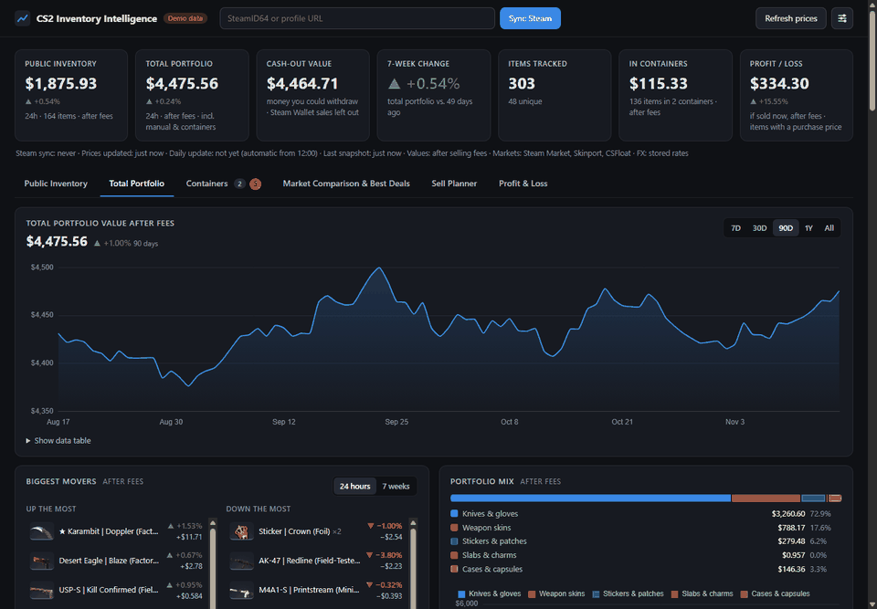
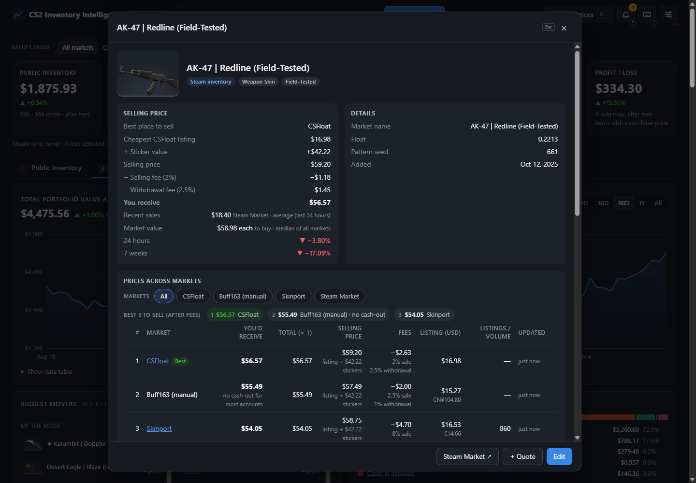
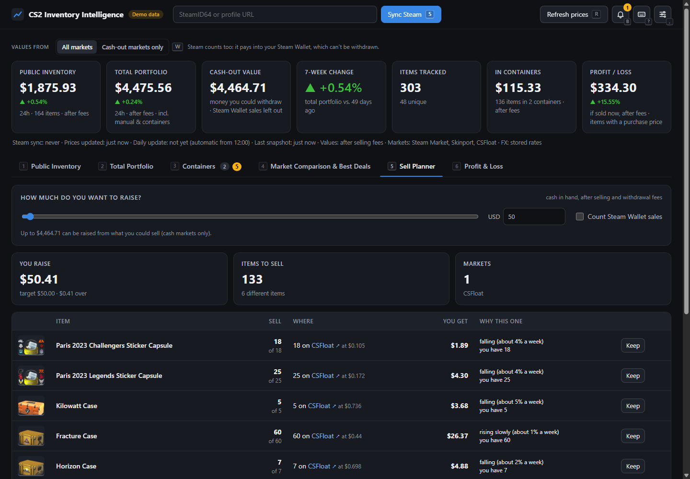
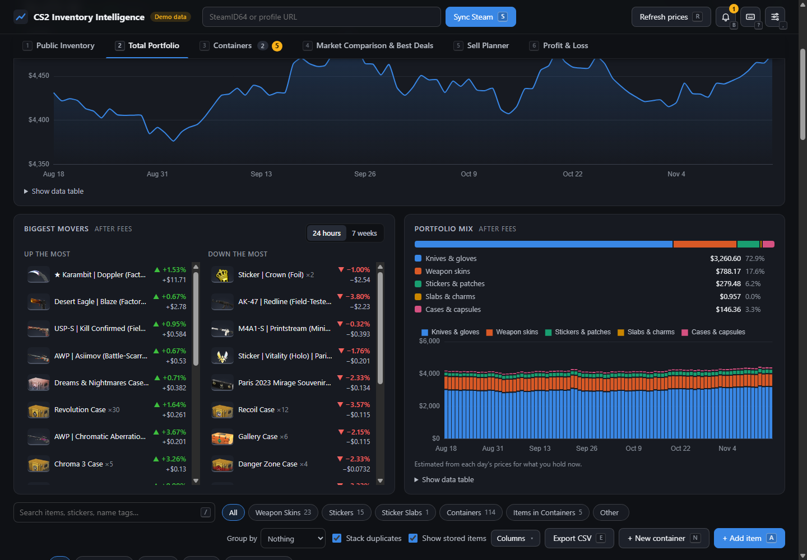
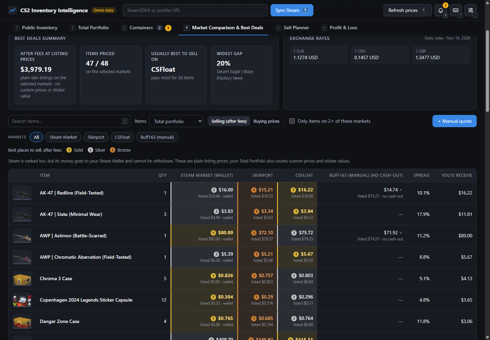
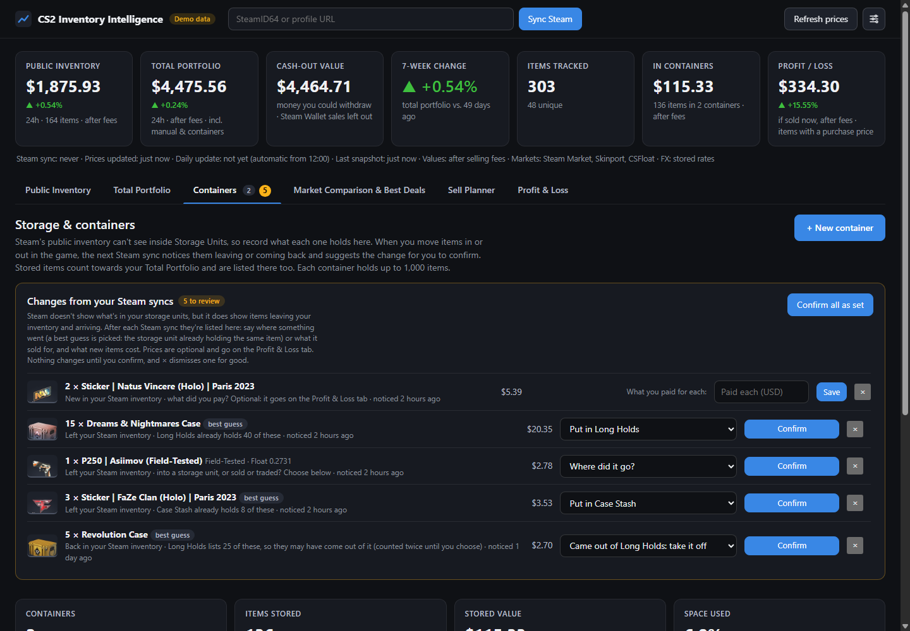
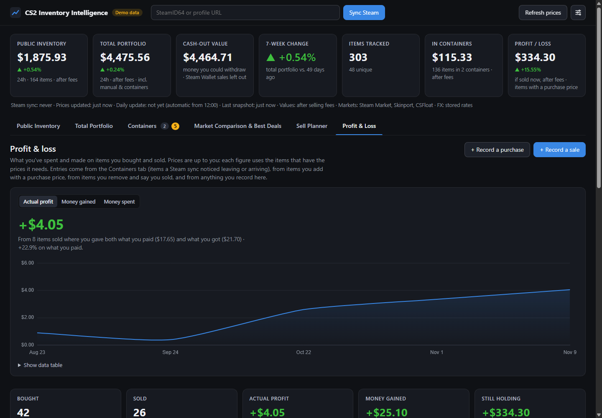

# CS2 Inventory Intelligence

[](https://github.com/IllyaHanslip/cs2-inventory-tracker/actions/workflows/tests.yml)
[](https://illyahanslip.github.io/cs2-inventory-tracker/)
[](https://github.com/IllyaHanslip/cs2-inventory-tracker/releases/latest)
[](LICENSE)

A local dashboard that tracks what your Counter-Strike 2 inventory is worth across **Steam, Skinport, CSFloat,
Market.CSGO and Waxpeer**, including your storage units, the real value of applied stickers, and how much cash
you'd actually walk away with after each site's fees.

It runs entirely on your own computer, only ever **reads** public price data, and never asks for your Steam
login.

**[Try the live demo](https://illyahanslip.github.io/cs2-inventory-tracker/)** (a made-up inventory, nothing to
install) · **[Download the Windows app](https://github.com/IllyaHanslip/cs2-inventory-tracker/releases/latest)**



> The demo, the GIF and the screenshots all use the built-in demo mode: a made-up inventory with synthetic prices.

## Features

- **Steam inventory sync**: paste your SteamID64 or profile link and your public CS2 inventory is imported,
  including applied stickers, name tags, and wear/pattern where Steam provides them.
- **Five markets plus your own**: lowest listings on Skinport, CSFloat, Market.CSGO and Waxpeer, what items sell
  for on the Steam Community Market (from [CSGOTrader](https://csgotrader.app)'s free daily price file, so the app
  never sends Steam a single price request), plus manual quotes for any other site (e.g. BUFF163) in any currency.
- **One currency**: every price is converted to your base currency (GBP, USD, EUR, CNY, …) with that day's
  European Central Bank rates, so comparisons are fair.
- **Containers and storage units**: Steam can't see inside Storage Units, so record what each one holds (up to
  1,000 items), with stacking, partial moves and removals, and a capacity bar.
- **Storage moves noticed for you**: after a Steam sync, items that left your inventory, came back or are new are
  listed on the Containers tab with a best guess of what happened: "15 Dreams & Nightmares Cases left: put them
  in *Long Holds* (it already holds 40)?" Confirm each one (or all at once), say it was sold and for how much, or
  give what a new item cost - or dismiss it with × for good.
- **Undo**: removing, moving, deleting a container, confirming a change from a Steam sync, deleting a Profit &
  Loss entry: the message that says it's done has an **Undo** button (or press Ctrl+Z).
- **Messages you can't miss**: messages in the corner stay 15-20 seconds, with a bar running down to when they
  go (pointing at one, or leaving the browser tab, pauses it) and × to close one. **Recent messages** (the button
  in the bottom corner, or H) lists everything from the last day with how long ago it came.
- **Several items at once**: tick items in a container (Shift+click ticks a run) and move or remove them together.
- **Price alerts**: "tell me when this sells for above / below £X" (after fees), set from any item's details. You're
  told in the dashboard and with a Windows notification; the bell at the top lists them.
- **Profit & Loss**: everything you've bought and sold, with prices only where you gave them (nobody remembers
  what they paid years ago). Switch between **actual profit** (sales where you gave both what you paid and what
  you got), **money gained** (everything you've sold for) and **money spent** (every purchase with a price),
  with a chart over time, a breakdown by kind of item, your best and worst sales,
  and the full list to edit. Sales come from the Containers tab, from removing an item you sold, or from
  recording one by hand.
- **Quick entry from an event**: pick a tournament (Budapest 2025…), narrow it to stickers, slabs or capsules
  and Gold, Holo…, and type how many you have of each. They go onto the container's list by their exact
  names for you to check before adding, alongside anything you typed yourself.
- **Realistic sticker values**: applied stickers add only a share of their loose price. Where the stickers are
  worth more than the skin, the item is valued from real CSFloat listings and sales of the same skin with the
  same stickers.
- **What you'd really get**: every price and value is what you'd receive selling, after each market's selling
  and withdrawal fees. The item view breaks it down step by step (listing price, sticker value, each fee).
- **Values from: all markets, or cash-out markets only**: Steam often pays most, but into your Steam Wallet,
  which can't be withdrawn. One switch above the figures (or W) makes every value, total, chart, mover and alert
  count only markets you can withdraw money from. Steam is still shown everywhere, greyed and listed last, and
  items only Steam has a price for are left out of totals. The other figure is always shown in its own tile.
- **No silly prices**: rarely traded items often have one listing priced far above what they sell for (say a
  Sticker Slab listed at £1,500 that sells for 62p). Those listings are spotted and ignored automatically, using
  recent sales, the other markets and, for slabs, the sticker inside. The item view shows what was ignored and why.
- **Selling many at once**: when you hold a stack (say 531 capsules), each market is counted for only about as
  many as it sells in a month, so the value is what you could really get, not the price of one times 531.
- **Sell planner**: choose an amount with a slider and it picks what to sell, how many and where: falling items
  first, copies from big stacks before one-offs, your most valuable items last. Narrow it to the items you'd sell
  (the same filters as your inventory: search, kinds of item, event, collection, wear, container…) and the markets
  you'd use; the slider shows how much those can raise. It assumes you list a little under each market's price so
  yours sell first (2% by default; choose 0-10%), and tells you what to list at.
- **Group by anything**: event (Paris 2023, Budapest 2025…), collection, type (knives, gloves, rifles…), weapon,
  rarity, wear or container, with subtotals.
- **Biggest movers and portfolio mix**: what rose and fell the most, and how your value splits across knives,
  skins, stickers, slabs and cases, now and over time.
- **History**: a daily snapshot builds 7-day to all-time charts of your portfolio and of each item on every
  market, after fees. An item's best-price line is striped with the colour of whichever market paid most that day. It can update in the background on days you don't open it, with a Windows notification
  saying what changed.
- **Easy to explore**: sort any column, choose which columns to show, filter by category or market, see the 3
  best markets to sell every item on, compare buying prices too, and export your inventory or Profit & Loss to
  CSV. Each tab remembers where you'd scrolled to.
- **Keyboard shortcuts**: 1-6 or [ and ] to change tabs, / to search, R to refresh, Ctrl+Z to undo and more (see
  [below](#keyboard-shortcuts)). Every button with a shortcut shows its key, and ? lists them all.

| Item detail | Sell planner | Movers and mix |
|---|---|---|
|  |  |  |
| **Market comparison** | **Containers** | **Profit & Loss** |
|  |  |  |

## Quick start (Windows)

**The easy way:** download **`CS2-Inventory-Intelligence.exe`** from the
[latest release](https://github.com/IllyaHanslip/cs2-inventory-tracker/releases/latest) and double-click it. No
Python or setup needed: it opens the dashboard in your browser, with a small window (and the app's icon on the
taskbar) that shows it's running - close that window to stop it. It keeps your data in
`%LOCALAPPDATA%\CS2 Inventory Intelligence` (put an optional `.env` there). Windows may warn that it's from an
unknown publisher, as it isn't code-signed: click **More info → Run anyway**. It's built automatically from this
code by GitHub Actions.

**From the source code:**

1. Install **Python 3.10 or newer** from [python.org](https://www.python.org/downloads/) and tick
   *"Add python.exe to PATH"* during setup.
2. Download this project: click the green **Code** button on this page, then either copy the link and run
   `git clone <link>`, or choose **Download ZIP** and unzip it.
3. Double-click **`launch.bat`**. The first run installs what it needs (1–2 minutes), then the dashboard opens
   in your browser at <http://127.0.0.1:5000>, with a small window that shows the app is running (close it to
   stop the app).
4. Paste your **SteamID64** into the box at the top and press **Sync Steam**. You can find it at
   *store.steampowered.com/account*. Your Steam inventory privacy must be set to **Public**.

To add a desktop shortcut (with an icon you can pin to the taskbar), run:

```powershell
powershell -ExecutionPolicy Bypass -File scripts\create-desktop-shortcut.ps1
```

**Just want to look around?** Run `launch.bat --demo` (or `python app.py --demo`) to open the app with a
synthetic demo inventory, stored separately from your real data.

### macOS, Linux, or manual setup

```bash
python3 -m venv .venv
source .venv/bin/activate          # Windows: .venv\Scripts\activate
pip install -r requirements.txt
cp .env.example .env               # optional - edit to add a CSFloat key
python app.py --open
```

The app keeps running while its window is open. Whenever you open it, it brings everything up to date straight
away (the **daily update**: Steam re-sync, prices, snapshot, if it hasn't run yet today), then refreshes prices
when they're over 12 hours old while it stays open. **Refresh prices** fetches immediately, any time.

**Keep it updating while the app is closed (Windows):** this adds a scheduled task, for your account only, that
runs the daily update in the background with no window, never before 12:00: at 12:00 if the PC is on, or as soon
as it's on after that. If the markets can't be reached (say the internet is down), it tries again the next hour.
Once today's update has happened, by the task or because you opened the dashboard, it does nothing more until
tomorrow; those hourly checks only read your local database and use no internet. Each run is noted in
`data\update.log`. Days the PC is off all day are skipped; charts carry the last value across.

When an update starts by itself - this background one, or the open app's own - a **Windows notification** says
so, and another sums up what it found when it's done: your total and the change since yesterday, the biggest riser and faller, how many items moved 10 %+ (`ALERT_MOVE_PCT`), items that now sell best
on a different market, and any unrealistic listings it ignored. Clicking it opens the dashboard. The script also
registers the notifications' name and the link they open, under your account only; if you set it up before
notifications existed, run it again. Turn them off with `NOTIFICATIONS=false`.

An update downloads about 6 MB (mostly the Skinport, Market.CSGO and Waxpeer price lists, plus Skinport's sales
history and the Steam price file, each fetched at most once a day or so). The one-per-item CSFloat requests are
small and spaced seconds apart, so they never hog a slow connection.

```powershell
powershell -ExecutionPolicy Bypass -File scripts\install-daily-update.ps1           # add -DryRun to preview
powershell -ExecutionPolicy Bypass -File scripts\install-daily-update.ps1 -Remove   # remove it again
```

To use another time, set `DAILY_UPDATE_TIME` in `.env` and pass the same time to the script with `-Time`.
Using the Windows app instead of Python? Add `-Exe "C:\path\to\CS2-Inventory-Intelligence.exe"`; the task then
runs the app with `--update`, and notifications open the app.

On other systems, schedule `python app.py --update` with cron or similar.

## Keyboard shortcuts

Every button with a shortcut shows its key, and **?** lists them all. They never fire while you're typing in a box.

| Key | What it does |
|---|---|
| **1**–**6** | Go to a tab (1 Public Inventory … 6 Profit & Loss) |
| **[** / **]** | Previous / next tab |
| **/** | Search the list on this tab (or in the container you have open) |
| **R** (**Shift+R**) | Refresh prices (every price, even ones fetched recently) |
| **S** | Sync your Steam inventory |
| **A** / **N** | Add an item / new container |
| **E** | Export this tab to CSV (inventory tabs and Profit & Loss) |
| **B** | Price alerts |
| **H** | Recent messages (the ones that popped up in the corner in the last day) |
| **W** | Values from: all markets / cash-out markets only |
| **,** | Settings |
| **Ctrl+Z** | Undo the last change |
| **Esc** | Close a window, leave a search box, or untick the items ticked in a container |
| **?** | Show all the shortcuts |

## Configuration

Settings live in a **`.env`** file next to `app.py`. Copy `.env.example` to `.env`; every value is optional.
Most of them can also be changed later in the app's **Settings** dialog.

| Setting | What it does |
|---|---|
| `CSFLOAT_API_KEY` | Enables CSFloat prices and sticker comparisons (see below). |
| `STEAM_ID64` | Your SteamID64, so you don't have to paste it each time. |
| `BASE_CURRENCY` | Currency everything is shown in, e.g. `GBP`, `USD`, `EUR`. |
| `ENABLED_MARKETS` | Any of `steam,skinport,csfloat,marketcsgo,waxpeer`. |
| `VALUATION_STRATEGY` | How an item's *market value* (its buying price, shown for reference) is picked from several markets: `median` (default), `lowest`, `highest`, `mean`, or a single market. |
| `STICKER_RATE_MIN` / `MAX`, `STICKER_PREMIUM_CAP` | Tune the sticker formula (5–15 % of loose price, capped at 100 % of the skin's price by default). |
| `HOST`, `PORT` | Where the local server listens (default `127.0.0.1:5000`; keep `127.0.0.1` so only your PC can open it). |
| `AUTO_DAILY_SNAPSHOT`, `AUTO_SYNC_STEAM` | Turn the automatic daily update and Steam re-sync on or off. |
| `DAILY_UPDATE_TIME` | Earliest time of day for the automatic background update (default `12:00`). |
| `BULK_SELL_DAYS` | For the "selling many at once" estimate: each market takes about what it sells in this many days (default `30`). |
| `ITEM_IMAGES` | Find pictures for items you add by hand (default `true`). |
| `NOTIFICATIONS` | Show a Windows notification when an automatic update starts and when it's done (default `true`). |
| `ALERT_MOVE_PCT` | An item moving at least this much (%) in a day is counted in that notification (default `10`). |

### API keys

The only key the app can use is an **optional CSFloat API key**: log in at [csfloat.com](https://csfloat.com),
open **Profile → Developers**, create a key, and put it in `.env` as `CSFLOAT_API_KEY=...`. Everything else
(Steam inventory, Steam Market, Skinport, Market.CSGO, Waxpeer, exchange rates) uses public, keyless endpoints.

- The key stays in your `.env` (which is git-ignored), is sent only to csfloat.com, and never reaches your
  browser.
- **This app never needs a Steam Web API key, so don't create one for it.** Fake "API key" pages are a common
  way to steal CS2 items. See [SECURITY.md](SECURITY.md).

## How values are worked out

- **Market prices**: each market's cheapest current listing of the item, converted with that day's exchange rate.
  The rates are checked again with every price update (at most every half hour), so a morning update doesn't keep
  using the day before's all day; when the European Central Bank's latest are more than a day old (weekends,
  holidays) the newer of the two sources is used.
- **Selling price** (what every price and value on the page shows): the most you'd receive on any market after
  its fees. For each market, that's its cheapest listing plus your stickers' value, minus the selling fee and
  withdrawal fee; the best market wins. Steam counts too, marked as Steam Wallet money. A **custom price** you
  set (or a CSFloat-comparables value) is treated as the item's full price and sold where fees are lowest.
- **Selling many at once**: a market only buys so many of one item. When you hold several copies, each market
  (best price first) is counted for about as many as it sells in 30 days, judged from its recent sales
  (Skinport's sales history); markets without sale counts (Steam, CSFloat) take the rest. So 531
  capsules aren't all valued at the price of a market that sells 8 a week. Copies spread across several entries
  or containers are pooled. **Value** and every total use this estimate; **Price** stays the best price for
  one, and the item view shows both, with each market's total for all your copies and how the estimate splits.
- **Price check**: a market's cheapest listing is only an asking price, so it's ignored when it's far above what
  the item goes for elsewhere - the middle of its prices on the other markets and its recent sales (Skinport's sales
  history, what it sold for on average on Steam, CSFloat's reference price). "Far above" is more than twice that on
  a market you can withdraw money from, more than 3 times on Steam (wallet money, naturally dearer) or with only one
  other figure to compare with, and always at least 10 cents above it - so cheap items are checked too. A Sticker
  Slab with nothing else to go on is compared with the sticker inside: a slab can be cracked open to get its
  sticker back, so it's worth at least that much, and is ignored above 4 times it. Cheap listings are never
  ignored. When every listing is ignored, the item is valued from its recent sales, or a slab from the sticker
  inside. This is a simple statistical rule rather than a trained model, so each decision can be explained.
  Rare patterns and floats aren't priced separately: an item is valued like the cheapest copy of that skin,
  so set a custom price for one that's worth more.
- **Market value**: what the item would cost to buy (the median of the markets by default), shown for reference
  in the item view and the Total portfolio tile's tooltip.
- **Applied stickers**:
  - Each sticker adds 5–15 % of its cheapest loose price. The rate rises on a log scale from $1 to $100
    stickers, is ×1.2 for four identical stickers, and is reduced by scrape.
  - The total is capped relative to the skin's own price, approaching the cap gradually.
  - When the stickers are worth more than the skin and a CSFloat key is set, the item is valued from CSFloat
    instead: recent sales and listings of the same skin with the same valuable stickers. Comparables carrying
    other valuable stickers are set aside, and asking prices are discounted. This is re-checked daily, and the
    item view shows the evidence.
- **Fees** (defaults as of November 2026, editable in Settings). With **Values from: Cash-out markets only**
  (or in the **Cash-out value** tile), each item is sold on the best market you can withdraw from:

  | Market | Selling fee | Withdrawal fee | Counts as cash? |
  |---|---|---|---|
  | Steam Market | 15 % on top of your amount (5 % Steam + 10 % CS2) | – | No, Steam Wallet only |
  | Skinport | 8 % (6 % on items worth €1,000+) | none | Yes |
  | CSFloat | 2 % | 2.5 % (lower at higher sales volume) | Yes |
  | Market.CSGO | 5 % | ~3 % (varies by method) | Yes |
  | Waxpeer | 6 % | ~2 % (crypto) | Yes |
  | BUFF163 (manual quotes) | 2.5 % | 1 % | No by default (only verified Chinese residents can withdraw) |

- **History and 24h / 7-week changes** come from the app's own daily snapshots, so they appear once it has run
  long enough. Item history is worked out after fees from each market's saved daily prices. Portfolio totals
  saved by older versions (at market value) are converted once, using each day's saved prices.
- **Changes count price moves only.** The chart line shows what your portfolio was worth each day, so it jumps
  when you add items, but a % change never counts added or removed items as a gain or loss: days when the
  number of items changed are left out (the chart says "price moves only" when that happened in its range).
  Today's point on the chart is always the value shown above it.
- **Portfolio mix over time** is an estimate for what you hold now: each item's value today, followed back
  through its own daily price.

## Data sources and limitations

- **Steam Community Market** prices come from [CSGOTrader](https://csgotrader.app)'s free price file: what each
  item sold for on average over the last 24 hours (or 7, 30 or 90 days for items that sell rarely), in US dollars,
  rebuilt once a day. The app downloads it (about 0.5 MB) at most every few hours, and only when it has changed,
  from CSGOTrader's server. It never asks Steam itself for prices, because Steam rate-limits that heavily, so there's
  nothing that could get your connection blocked by Steam. Being an average of real sales rather than the cheapest
  listing right now, it can be a day behind sudden moves, and it has no sale counts.
- **Skinport, Market.CSGO and Waxpeer** publish free price lists. They're fetched once and cached for 30
  minutes. **CSFloat** uses its official API. Skinport's public **sales history** (what items actually sold for
  over the last 7–90 days) is fetched the same way and used for the price check.
- **Item names** for autocomplete come from CSFloat's public item list (downloaded weekly, no key needed) plus
  the market price lists, so you can add items nobody is selling right now, such as an unlisted Sticker Slab.
- **Pictures for items you add by hand** are looked up in [ByMykel's CSGO-API](https://github.com/ByMykel/CSGO-API)
  item catalogue on GitHub. Only the file for that kind of item is downloaded (about 1 MB), at most once a day,
  and the pictures themselves load from Steam like synced items. Set `ITEM_IMAGES=false` to turn this off.
- **Marketplaces that need your login** (such as BUFF163) are deliberately not automated. Add their prices
  as manual quotes.
- **Storage units** aren't listed in public Steam inventories at all (Steam counts them in the inventory's
  total but doesn't show them, or what's in them), so their contents and item counts are entered by hand, or
  confirmed from what a sync noticed leaving or coming back. Only the public inventory is read, never your account.
- **CSFloat** prices are fetched one item at a time. If CSFloat answers "too many requests", the app leaves it
  alone for a while (1 hour, then longer each time, up to a day) instead of asking again on every refresh, and
  then fetches your most valuable items first. The banner at the top shows each market's progress and how long
  is left.
- **Estimates only**: fees change, sticker values are estimates, and none of this is financial advice.

## Privacy and security

- **Local and read-only**: the server only listens on `127.0.0.1`, there are no accounts, and nothing can trade
  or move items.
- **Your data stays private**: your keys (`.env`), database and exports (`data/`) are git-ignored.
- **Privacy check**: `scripts/check_secrets.py` blocks API keys, real SteamIDs, email addresses, personal file
  paths and private files from being committed. Turn on the pre-commit hook in your clone with
  `git config core.hooksPath .githooks`.
- **Reporting problems**: see [SECURITY.md](SECURITY.md) for what the app will never ask for, and how to report
  a vulnerability.

## Development

```bash
pip install -r requirements-dev.txt
python -m pytest                     # test suite (no network needed)
python scripts/check_secrets.py      # privacy check of everything that would be committed
python scripts/build_demo_site.py --out site   # the static live demo (what GitHub Pages serves)
```

To build the one-file Windows app yourself:

```bash
pip install -r requirements-build.txt
pyinstaller packaging/cs2-inventory.spec --noconfirm   # -> dist/CS2-Inventory-Intelligence.exe
```

Pushing a version tag (`v1.2.0`) builds it on GitHub Actions and publishes it as a release; every push to `main`
rebuilds the live demo.

| Path | Contents |
|---|---|
| `app.py`, `config.py` | Entry point and settings |
| `backend/` | Flask API, SQLite storage, Steam sync, market sources, valuation, fees, history, the app's window |
| `static/`, `templates/` | The dashboard (vanilla JavaScript + Chart.js) |
| `tests/` | pytest suite |
| `scripts/` | Privacy check, desktop-shortcut helper, the daily-update scheduled task and the live-demo builder |
| `packaging/` | PyInstaller recipe and release notes for the Windows app |
| `.github/workflows/` | Tests, the live demo (GitHub Pages) and the Windows app release |

## Credits

- **Price data:** Steam Community Market (average sale prices from [CSGOTrader](https://csgotrader.app)'s free
  daily price file, by the open-source CSGO Trader browser extension), [Skinport](https://skinport.com), [CSFloat](https://csfloat.com),
  [Market.CSGO](https://market.csgo.com) and [Waxpeer](https://waxpeer.com). Sales history comes from Skinport
  and those Steam averages; CSFloat's reference price fills in when neither has the item.
- **Exchange rates:** [Frankfurter](https://frankfurter.dev) (European Central Bank), with
  [ExchangeRate-API](https://www.exchangerate-api.com) as a fallback.
- **Item names and pictures:** CSFloat's public item schema and [ByMykel's CSGO-API](https://github.com/ByMykel/CSGO-API)
  (MIT); the pictures are served by Steam.
- **Charts:** [Chart.js](https://www.chartjs.org) (MIT).

This is an unofficial project, not affiliated with or endorsed by Valve Corporation, Steam, or any of the
marketplaces above. Counter-Strike and Steam are trademarks of Valve Corporation. Item images are loaded from
Steam when the app runs and are not included in this repository.

## License

[MIT](LICENSE) © 2026 Illya Hanslip
